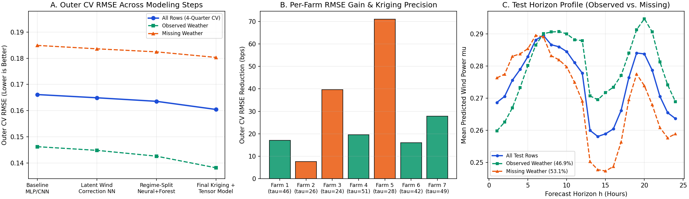
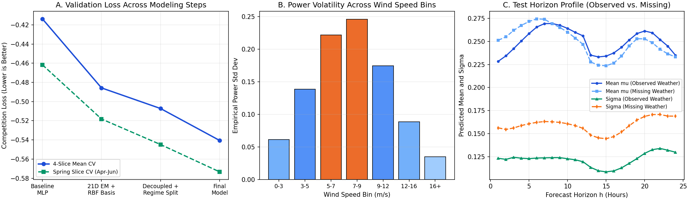

# Wind Power Mean and Uncertainty Forecasting

Forecasting normalized wind power **1-24 hours ahead across seven wind farms**, with separate point and probabilistic forecasting tracks. Developed for the **Bogazici University MATH482 Kaggle course competitions** in October 2026.

The project explores structured missing weather forecasts, spatial dependence between farms, chronological validation, and calibrated predictive uncertainty.

## Results

| Course competition | Metric, lower is better | Public leaderboard | Private leaderboard | Final private rank |
| --- | --- | ---: | ---: | ---: |
| [Mean forecasting](https://www.kaggle.com/competitions/math482-wind-power-mean-2026) | RMSE | 0.17260 | **0.16376** | **11th** |
| [Uncertainty forecasting](https://www.kaggle.com/competitions/math482-wind-power-uncertainty-2026) | Gaussian NLL plus a second-moment penalty | -0.39422 | **-0.51521** | **5th** |

Scores and ranks are reported in the submitted competition notebooks. They refer to course competitions, not an open global Kaggle competition. Hidden test labels are not included, so leaderboard scores cannot be recomputed here.

## The forecasting problem

The notebooks describe 141,540 training rows and 9,408 test rows. Weather forecasts are missing in **4,992 test rows (53.06%)**, often in complete farm-day blocks. On **12 test issue dates**, the available test horizons begin at hour 13 rather than hour 1.

The feature pipeline uses weather forecasts available at the current issue time or earlier. Known later lead times from the same forecast issue are different from future forecast issues: the former may already be available when making a prediction.

## Approach

- **Weather reconstruction:** Gaussian EM imputation uses cross-farm weather relationships; the extended approach also uses adjacent forecast leads and decaying information from the previous issue cycle.
- **Mean forecasting:** neural baselines, specialists for observed and missing weather, multi-lag tensor Ridge models and Kriging are described in the report. The final saved component predictions are combined with a regularized spectral ensemble.
- **Uncertainty forecasting:** probabilistic neural networks estimate a mean and positive standard deviation. The report compares joint and decoupled objectives, combines model disagreement through the law of total variance, and adjusts variance for bounded power output.
- **Validation:** chronological seasonal splits are documented. The supplied evaluation summaries report an outer RMSE change from 0.163544 to 0.160431. These are historical records; raw out-of-fold predictions needed to independently rerun that evaluation are not included.

The uncertainty competition loss is:

$$
L(y,\mu,\sigma)=\frac{1}{2}\log(2\pi)+\log\sigma+\frac{(y-\mu)^2}{2\sigma^2}+5(y^2-\mu^2-\sigma^2)^2.
$$

The final mean blend also uses public leaderboard RMSE feedback to construct its weights. The archived seasonal validation results should therefore not be interpreted as a fresh, untouched evaluation of every final blend choice.

## Diagnostics

The figures below are supplied competition diagnostics, retained with the reports.





## Reproduce the saved predictions

**The checked workflow replays saved prediction artifacts. It does not retrain the full competition pipeline.** No competition data download is required for this replay.

```bash
python -m venv .venv
# Activate the environment using the command for your operating system.
python -m pip install -r requirements.txt
python scripts/replay_artifacts.py
```

The script:

1. Checks the original submission SHA-256 hashes, schemas, unique IDs, finite predictions and positive uncertainty values.
2. Recomputes the mean blend from saved component prediction arrays and exports the cached final uncertainty arrays.
3. Compares both results with the reference submissions and writes CSVs to `reproduced/`.

Both CSV hashes matched the reference files in the packaging check. Floating-point libraries can cause small platform differences in the mean blend; the script also checks a maximum absolute tolerance of `1e-7`. It reports exact hash agreement separately.

See [reproducibility details](docs/reproducibility.md) for the artifact contract, historical outputs and remaining training-code gaps.

## Repository layout

```text
mean_forecasting.ipynb                 Competition report and historical outputs
uncertainty_forecasting.ipynb          Competition report and historical outputs
mean_research/                        Saved mean components and evaluation summaries
uncertainty_research/                 Saved final uncertainty arrays
submissions/                          Reference competition submissions
scripts/replay_artifacts.py           Checked artifact replay
assets/                               Supplied diagnostic figures
docs/reproducibility.md                Scope and verification notes
requirements.txt                      Dependencies for artifact replay
requirements-notebooks.txt            Additional notebook dependencies
```

To explore the historical notebooks, install `requirements-notebooks.txt` and start Jupyter from the repository root. Full notebook execution additionally requires authorized competition data (`train.csv`, `test.csv`, `sample_submission.csv`), can run expensive training sections, and is **not the verified replay path**. Original specialist training sources and weights remain outside this release.

## Author and assistance

**Doga Duran** - BSc Mathematics, Bogazici University  
[GitHub](https://github.com/doaduran) | [LinkedIn](https://linkedin.com/in/doga-duran)

The submitted reports disclose GitHub Copilot and Google Gemini assistance with implementation and debugging. That disclosure is retained in the notebooks. Portfolio packaging and the artifact replay script were prepared with OpenAI Codex assistance; this did not rerun model training or independently certify the reported competition scores.
